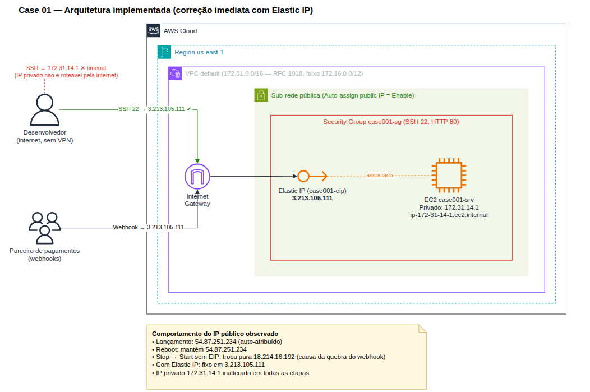
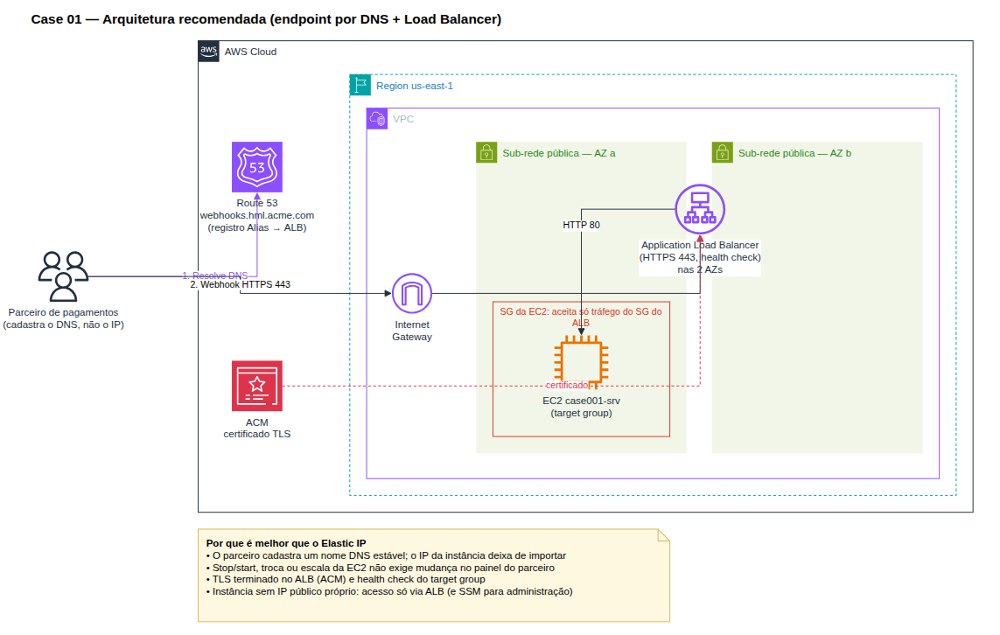

# Case 01 — Solução: O servidor que "sumiu" toda manhã

Registro da execução, das evidências e das conclusões do case.

## Resumo

| Etapa                     | IP público       | IP privado    | Observação                                   |
| ------------------------- | ---------------- | ------------- | -------------------------------------------- |
| Lançamento                | `54.87.251.234`  | `172.31.14.1` | IP público auto-atribuído                     |
| Pós-reboot                | `54.87.251.234`  | `172.31.14.1` | Nenhum IP mudou                               |
| Pós-stop/start (sem EIP)  | `18.214.16.192`  | `172.31.14.1` | IP público trocado; o antigo não responde     |
| Com EIP                   | `3.213.105.111`  | `172.31.14.1` | Mantido após reboot (stop/start não registrado) |
| Pós-disassociate          | —                | —             | Infra removida via `terraform destroy`        |

- **Hostname / Private IPv4 DNS:** `ip-172-31-14-1.ec2.internal`
- **Faixa RFC 1918 do IP privado:** `172.31.14.1` ∈ `172.16.0.0/12`

## Arquitetura

Diagramas editáveis em [architecture.drawio](architecture/architecture.drawio).

### Implementada (correção imediata com Elastic IP)



### Recomendada (Route 53 + Application Load Balancer)



---

## Preparação do ambiente

Infraestrutura provisionada via Terraform ([iac/](iac/)):

- Instância EC2 com `associate_public_ip_address = true`
- Security Group
- Key Pair
- Elastic IP alocado, mas **ainda não associado** à instância

## Fase 1 — Montar o ambiente

Valores registrados logo após o lançamento:

| Atributo         | Valor                         |
| ---------------- | ----------------------------- |
| IP público       | `54.87.251.234`               |
| IP privado       | `172.31.14.1`                 |
| Private IPv4 DNS | `ip-172-31-14-1.ec2.internal` |
| Faixa RFC 1918   | `172.16.0.0/12`               |

## Fase 2 — Reproduzir e diagnosticar (reclamações 2 e 3)

### SSH pelo IP público: sucesso

```console
❯ ssh -i case001.pem ubuntu@54.87.251.234
Welcome to Ubuntu 24.04.5 LTS (GNU/Linux 7.0.0-1014-aws x86_64)
...
  IPv4 address for ens5: 172.31.14.1
...
ubuntu@ip-172-31-14-1:~$
```

O hostname `ip-172-31-14-1` é derivado diretamente do IP privado `172.31.14.1`.

### SSH pelo IP privado: falha (reclamação 2)

```console
❯ ssh -i case001.pem ubuntu@172.31.14.1
ssh: connect to host 172.31.14.1 port 22: Connection timed out
```

O IP privado (RFC 1918) só é roteável dentro da VPC ou via VPN/Direct Connect. A partir da internet, a conexão não tem rota e dá timeout.

### Reboot (reclamação 3)

Após **Reboot instance**, o IP público continuou `54.87.251.234`. O reboot não libera o IP público, por isso "nada quebrou" quando reiniciaram o servidor durante o dia.

## Fase 3 — Reproduzir a causa raiz (reclamação 1)

Após **Stop → Start**:

- Novo IP público: `18.214.16.192`
- IP privado e Private DNS **permaneceram os mesmos**

### SSH pelo IP antigo: falha

```console
❯ ssh -i case001.pem ubuntu@54.87.251.234
ssh: connect to host 54.87.251.234 port 22: Connection timed out
```

### SSH pelo IP novo: sucesso

```console
❯ ssh -i case001.pem ubuntu@18.214.16.192
Welcome to Ubuntu 24.04.5 LTS (GNU/Linux 7.0.0-1014-aws x86_64)
...
  IPv4 address for ens5: 172.31.14.1
...
ubuntu@ip-172-31-14-1:~$
```

### Por que a integração quebra toda manhã?

O IP público auto-atribuído vem do pool da AWS e é **devolvido no stop**. No start a instância recebe outro IP, então o endpoint cadastrado no painel do parceiro passa a apontar para um IP que não é mais da instância, e os webhooks dão timeout. O reboot não libera o IP, por isso só o ciclo noturno de stop/start causa o problema.

## Fase 4 — Correção imediata com Elastic IP

- Elastic IP associado à instância: `3.213.105.111`
- O IP público anterior (`18.214.16.192`) **deixou de responder** ao SSH após a associação
- Após reboot, a instância **manteve** o mesmo IP

```console
❯ ssh -i case001.pem ubuntu@3.213.105.111
Welcome to Ubuntu 24.04.5 LTS (GNU/Linux 7.0.0-1014-aws x86_64)
...
  IPv4 address for ens5: 172.31.14.1
...
ubuntu@ip-172-31-14-1:~$
```

## Fase 5 — Desmontagem

- Elastic IP desassociado
- Infraestrutura removida (`terraform destroy`). Como o EIP é gerenciado pelo Terraform, o destroy também faz o **Release**.

## Fase 6 — Recomendação de arquitetura

O Elastic IP resolve o sintoma, mas prende a integração a um IP específico. É um recurso limitado (5 por região), cobrado mesmo sem uso e que precisa ser recadastrado no parceiro se a instância for substituída ou migrada. A recomendação para a Acme Digital é cadastrar no parceiro um **nome DNS** (ex.: `webhooks.hml.acme.com`) em vez de um IP. Esse nome fica no **Route 53**, apontando para um **Application Load Balancer** com a instância no target group. Assim, o servidor pode ser parado, trocado ou escalado sem nenhuma alteração do lado do parceiro, e o ALB ainda permite terminar TLS (HTTPS) e fazer health check.

Veja o diagrama em [Arquitetura recomendada](#recomendada-route-53--application-load-balancer).

---

## Fora do escopo deste case

O foco deste lab é endereçamento IP no EC2 (IP público × privado, reboot × stop/start e Elastic IP). Por isso, algumas boas práticas ficaram de fora de propósito. Elas são necessárias em um ambiente produtivo e serão exploradas em cases futuros:

- **Alta disponibilidade e Multi-AZ:** a arquitetura recomendada mostra o ALB em duas AZs, mas com uma única instância. Faltam um Auto Scaling Group com instâncias distribuídas entre AZs e políticas de escalonamento.
- **Isolamento de rede:** a instância deveria ficar em **sub-rede privada**, sem IP público. A saída para a internet seria por NAT Gateway, e só o ALB ficaria exposto.
- **Acesso administrativo:** trocar o SSH com chave `.pem` e a porta 22 aberta por **AWS Systems Manager Session Manager**, com acesso controlado por IAM e auditado.
- **Security Groups com menor privilégio:** neste lab o SG libera SSH e HTTP para `0.0.0.0/0`. O mínimo seria restringir ao IP de origem (`/32`) ou ao SG do ALB.
- **Proteção de borda:** **AWS WAF** no ALB, com regras gerenciadas (OWASP, rate limiting e allowlist dos IPs do parceiro), e **AWS Shield**.
- **Segurança do webhook:** validação de assinatura (HMAC) das requisições do parceiro e HTTPS fim a fim.
- **Observabilidade:** métricas e alarmes no CloudWatch, access logs do ALB, VPC Flow Logs e CloudTrail.
- **Governança do IaC:** backend remoto do Terraform (S3 com state locking), módulos com versão fixada (`?ref=<tag>`) e pipeline de CI/CD com revisão antes do `apply`.
- **Custo e agendamento:** automatizar o stop/start noturno (EventBridge Scheduler ou Instance Scheduler) e avaliar o custo do IPv4 público do ALB.

---