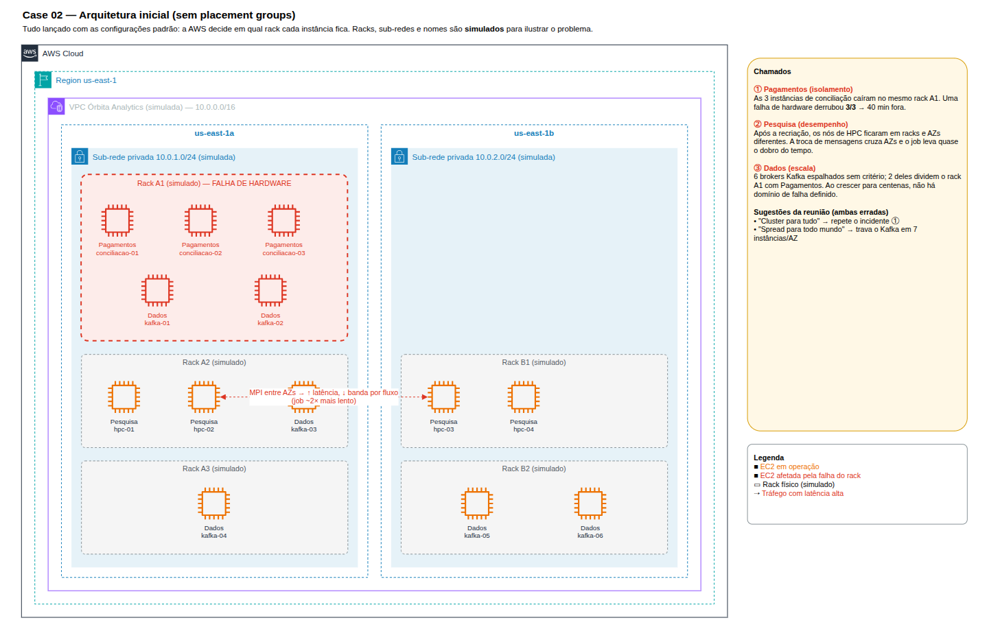
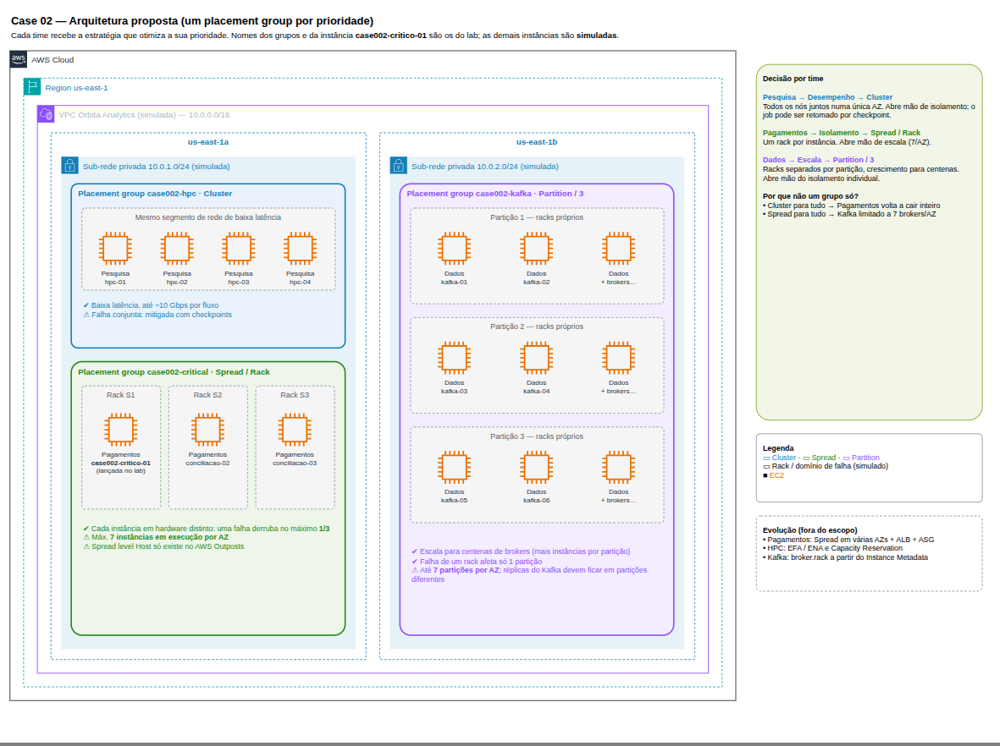

# Case 02 — Solução: Desempenho, isolamento ou escala?

Registro da execução, das evidências e das conclusões do case.

## Resumo

| Placement group    | Estratégia | Spread level / Partições | Time       | Prioridade  | Observação |
| ------------------ | ---------- | ------------------------ | ---------- | ----------- | ---------- |
| `case002-hpc`      | Cluster    | —                        | Pesquisa   | Desempenho  | Criado, validado e removido |
| `case002-critical` | Spread     | Rack                     | Pagamentos | Isolamento  | Recebeu a instância `case002-critico-01`; exclusão bloqueada enquanto em uso |
| `case002-kafka`    | Partition  | 3 partições              | Dados      | Escala      | Criado, validado e removido |

- **Região:** `us-east-1`
- **Instância de validação:** `case002-critico-01` (`t3.micro`, `us-east-1a`), no grupo `case002-critical`
- **Conta ao final:** instância `terminated`, nenhum placement group na região, state do Terraform vazio

## Arquitetura

Diagramas editáveis em [architecture.drawio](architecture/architecture.drawio).

### Inicial (sem placement groups)

A arquitetura descrita no case: tudo lançado com as configurações padrão, e a AWS decide em qual rack cada instância fica. A VPC, as sub-redes, os racks e os nomes das instâncias são **simulados** para mostrar por que os três times têm problemas.



### Proposta (um placement group por prioridade)

Cada time recebe a estratégia que otimiza a sua prioridade: **Cluster** para desempenho, **Spread / Rack** para isolamento e **Partition / 3** para escala. Nenhuma estratégia serve para os três.



> Apenas `case002-critico-01` foi lançada de fato no lab. As demais instâncias aparecem no diagrama só para ilustrar como cada estratégia distribui as instâncias.

---

## Preparação do ambiente

Infraestrutura provisionada via Terraform ([iac/](iac/)), com módulos do repositório [Terraform-Modules](https://github.com/mgsantos89/Terraform-Modules):

- 3 placement groups (módulo `PlacementGroup`): Cluster, Spread/Rack e Partition/3
- 1 instância EC2 `t3.micro` (módulo `EC2`) vinculada ao placement group Spread
- Variáveis de exemplo em [iac/example.tfvars](iac/example.tfvars)

## Fase 1 — Diagnóstico dos chamados

Os três problemas estão representados na [arquitetura inicial](#inicial-sem-placement-groups): o rack A1 com as 3 instâncias de Pagamentos, os nós de HPC divididos entre duas AZs e os brokers Kafka espalhados sem critério.

### Por que as 3 instâncias do time de Pagamentos caíram juntas?

Sem placement group, a AWS posiciona as instâncias onde houver capacidade e **não garante que elas fiquem em hardware distinto**. As três podem ter ido para o mesmo rack, com a mesma energia e o mesmo switch, e uma única falha física derrubou todas. Ter três instâncias não significa ter três domínios de falha.

### O que mudou no ambiente do time de Pesquisa?

Na recriação, os nós provavelmente foram lançados espalhados entre racks ou até em sub-redes de AZs diferentes. Com isso, ficaram em racks distantes, e cada salto de rede a mais (ou tráfego entre AZs) aumenta a latência, o que pesa muito num job de HPC que troca mensagens o tempo todo.

### Prioridade de cada time

| Time       | Prioridade principal | O que pode sacrificar em troca |
| ---------- | -------------------- | ------------------------------ |
| Pesquisa   | **Desempenho**       | **Isolamento e disponibilidade.** Todos os nós ficam juntos numa única AZ e podem falhar juntos. É aceitável porque um job de HPC pode ser reexecutado ou retomado a partir de um checkpoint. |
| Pagamentos | **Isolamento**       | **Escala e latência mínima.** Cada instância fica em um rack diferente, com limite de 7 instâncias por AZ. São poucas instâncias, e o que importa é nunca perder todas ao mesmo tempo. |
| Dados      | **Escala**           | **Isolamento individual.** Instâncias da mesma partição compartilham racks e podem cair juntas. O Kafka compensa isso distribuindo as réplicas de cada tópico entre partições diferentes, então a falha de um rack afeta só uma fração dos brokers. |

## Fase 2 — Criar os placement groups

Os 3 placement groups foram provisionados via Terraform ([iac/module.tf](iac/module.tf)), usando o módulo `PlacementGroup`, na região `us-east-1`.

| Módulo                     | Nome               | Estratégia  | Parâmetro               | Time       |
| -------------------------- | ------------------ | ----------- | ----------------------- | ---------- |
| `placement_group_hpc`      | `case002-hpc`      | `cluster`   | —                       | Pesquisa   |
| `placement_group_critical` | `case002-critical` | `spread`    | `spread_level = "rack"` | Pagamentos |
| `placement_group_kafka`    | `case002-kafka`    | `partition` | `partition_count = 3`   | Dados      |

Todos recebem as tags `Environment`, `Project` e `ManagedBy = Terraform`.

### Evidência: placement groups criados

```console
❯ aws ec2 describe-placement-groups --region us-east-1 \
    --filters "Name=group-name,Values=case002-*" \
    --query 'PlacementGroups[].[GroupName,Strategy,SpreadLevel,PartitionCount,State]' \
    --output table
----------------------------------------------------------------
|                    DescribePlacementGroups                   |
+-------------------+------------+-------+-------+-------------+
|  case002-critical |  spread    |  rack |  None |  available  |
|  case002-hpc      |  cluster   |  None |  None |  available  |
|  case002-kafka    |  partition |  rack |  3    |  available  |
+-------------------+------------+-------+-------+-------------+
```

O resultado confere com o critério de aceite: **Cluster**, **Spread / Rack** e **Partition / 3 partições**, todos no estado `available`.

O `case002-kafka` também aparece com `SpreadLevel = rack`. Isso é esperado: no Partition, cada partição ocupa um conjunto próprio de racks, e a AWS informa esse nível de distribuição mesmo sem ele ter sido configurado.

### Tabela de evidências — placement groups

| Placement group    | Estratégia | Spread level / Partições | Estado      | Observação |
| ------------------ | ---------- | ------------------------ | ----------- | ---------- |
| `case002-hpc`      | Cluster    | —                        | `available` | 1 AZ, baixa latência (Pesquisa) |
| `case002-critical` | Spread     | Rack                     | `available` | Hardware distinto, máx. 7 instâncias por AZ (Pagamentos) |
| `case002-kafka`    | Partition  | 3 partições              | `available` | Até 7 partições por AZ, centenas de instâncias (Dados) |

### Por que o Spread level Host não foi usado?

O nível **Host** só existe para instâncias em **AWS Outposts** (hardware da AWS instalado no data center do cliente). Na região AWS, o isolamento disponível no Spread é por **rack**: cada instância fica em um rack com energia e rede próprias, o que é exatamente o que o time de Pagamentos precisa.

## Fase 3 — Lançar uma instância no grupo certo

A instância `case002-critico-01` foi lançada via Terraform pelo módulo `ec2` ([iac/module.tf](iac/module.tf)). O vínculo com o grupo é feito pelo argumento `placement_group`, que recebe a saída do módulo do Spread. É o equivalente, no Terraform, ao campo **Advanced details → Placement group name** da console:

```hcl
placement_group = module.placement_group_critical.placement_group_name
```

### Evidência: instância vinculada ao grupo

```console
❯ aws ec2 describe-instances --region us-east-1 \
    --filters "Name=tag:Name,Values=case002-critico-01" \
    --query 'Reservations[].Instances[].[Tags[?Key==`Name`]|[0].Value,InstanceType,Placement.AvailabilityZone,Placement.GroupName,State.Name]' \
    --output table
---------------------------------------------------------------------------------
|                               DescribeInstances                               |
+---------------------+-----------+-------------+--------------------+----------+
|  case002-critico-01 |  t3.micro |  us-east-1a |  case002-critical  |  running |
+---------------------+-----------+-------------+--------------------+----------+
```

O campo `Placement.GroupName` da instância é o mesmo que aparece como **Placement group** na aba **Details** da console, e confirma o vínculo com `case002-critical`, o grupo Spread/Rack do time de Pagamentos.

### Instância de validação

| Atributo                | Valor                     |
| ----------------------- | ------------------------- |
| Instance ID             | `i-03b42fd3a407e7c4d`     |
| Tipo / AZ               | `t3.micro` / `us-east-1a` |
| Placement group         | `case002-critical`        |
| Estado                  | `running`                 |

### Por que o time de Pagamentos não poderia escalar para 10 instâncias numa única AZ com este grupo?

Porque um placement group **Spread** aceita no máximo **7 instâncias em execução por AZ**: a 8ª instância em `us-east-1a` seria recusada. Para passar disso, seria preciso distribuir as instâncias entre várias AZs (7 por AZ) ou migrar para **Partition**, abrindo mão do isolamento individual por instância.

## Fase 4 — Testar os limites

### Excluir um placement group que está em uso

Com a instância `case002-critico-01` ainda em execução dentro do grupo, foi feita a tentativa de exclusão:

```console
❯ aws ec2 delete-placement-group --region us-east-1 --group-name case002-critical
aws: [ERROR]: An error occurred (InvalidPlacementGroup.InUse) when calling the DeletePlacementGroup operation: The placement group 'case002-critical' is in use and may not be deleted.
```

Logo depois, o grupo continuava existindo:

```console
❯ aws ec2 describe-placement-groups --region us-east-1 \
    --group-names case002-critical \
    --query 'PlacementGroups[].[GroupName,Strategy,State]' \
    --output table
---------------------------------------------
|          DescribePlacementGroups          |
+-------------------+---------+-------------+
|  case002-critical |  spread |  available  |
+-------------------+---------+-------------+
```

A AWS bloqueia a exclusão com o erro `InvalidPlacementGroup.InUse`: um placement group **só pode ser excluído quando está vazio**. Antes, é preciso encerrar as instâncias ou movê-las para fora do grupo (a instância parada pode ter o placement alterado com `modify-instance-placement`).

### O que aconteceria com a simulação do time de Pesquisa se o hardware compartilhado do `case002-hpc` falhasse?

A simulação inteira pararia. No Cluster, todos os nós ficam próximos, numa única AZ e no mesmo segmento de rede, e por isso uma falha nesse hardware ou nessa AZ derruba vários nós (ou todos) de uma vez. É o preço da baixa latência. O time mitiga com **checkpoints** periódicos para retomar o job em vez de recomeçar do zero e, se precisar, relança o cluster em outra AZ.

### Por que "Spread para todo mundo" não serve?

Porque o Spread aceita no máximo **7 instâncias em execução por AZ**. Mesmo usando as 6 AZs de `us-east-1`, o teto seria de cerca de 42 brokers, muito longe das centenas planejadas para o Kafka do time de Dados. O **Partition** resolve isso: cada partição pode ter muitas instâncias, e o isolamento passa a ser por grupo de racks, e não por instância.

### Por que "Cluster para tudo" não serve?

Porque o Cluster faz exatamente o contrário do que Pagamentos precisa: **junta** as instâncias no mesmo hardware, numa única AZ. Com as 3 instâncias de conciliação no mesmo grupo Cluster, uma única falha física voltaria a derrubar todas ao mesmo tempo, que é o incidente de 40 minutos que o time quer evitar.

## Fase 5 — Desmontagem sem resíduo

Infraestrutura removida com `terraform destroy`. O Terraform respeita a dependência entre os módulos: primeiro encerra a instância e só depois exclui os placement groups, a mesma ordem que a Fase 4 mostrou ser obrigatória.

### Evidência: instância encerrada

```console
❯ aws ec2 describe-instances --region us-east-1 \
    --filters "Name=tag:Project,Values=case002" \
    --query 'Reservations[].Instances[].[InstanceId,Tags[?Key==`Name`]|[0].Value,Placement.GroupName,State.Name]' \
    --output table
---------------------------------------------------------------------------------
|                               DescribeInstances                               |
+---------------------+----------------------+--------------------+-------------+
|  i-03b42fd3a407e7c4d|  case002-critico-01  |  case002-critical  |  terminated |
+---------------------+----------------------+--------------------+-------------+
```

### Evidência: nenhum placement group na região

```console
❯ aws ec2 describe-placement-groups --region us-east-1 --output json
{
    "PlacementGroups": []
}
```

### Evidência: state do Terraform vazio

```console
❯ terraform state list
❯
```

## Fase 6 — Tabela de decisão

Tabela entregue aos três times como justificativa das escolhas:

| Time       | Prioridade     | Estratégia                       | Motivo da escolha | Principal risco / limite |
| ---------- | -------------- | -------------------------------- | ----------------- | ------------------------ |
| Pesquisa   | **Desempenho** | **Cluster** (`case002-hpc`)      | Nós próximos numa **única AZ**, com a menor latência e a maior banda entre instâncias (até **~10 Gbps** por fluxo), ideal para HPC com muita troca de mensagens. | **Falha conjunta**: uma falha de hardware ou da AZ derruba o cluster inteiro. Lançar todas as instâncias de uma vez, com o mesmo tipo, reduz o risco de erro de capacidade. |
| Pagamentos | **Isolamento** | **Spread / Rack** (`case002-critical`) | Cada instância em **hardware distinto** (rack próprio, com energia e rede separadas). Uma falha física derruba no máximo uma das 3 instâncias de conciliação. | **Máximo de 7 instâncias em execução por AZ** por grupo. O Spread level Host só existe no **AWS Outposts**. |
| Dados      | **Escala**     | **Partition / 3** (`case002-kafka`) | As partições ficam em **racks separados** e podem ter muitas instâncias cada, permitindo crescer para **centenas de brokers**. O Kafka usa as partições como domínio de falha para distribuir as réplicas. | **Até 7 partições por AZ**. Instâncias da mesma partição compartilham racks e podem cair juntas, então a distribuição de réplicas precisa levar as partições em conta. |

---

## Critérios de aceite

| # | Critério | Status | Evidência |
| - | -------- | ------ | --------- |
| 1 | Os 3 placement groups com a estratégia correta: **Cluster**, **Spread / Rack** e **Partition / 3 partições** | ✅ Atendido | [Fase 2](#evidência-placement-groups-criados) |
| 2 | A instância `case002-critico-01` exibe `case002-critical` como placement group | ✅ Atendido | [Fase 3](#evidência-instância-vinculada-ao-grupo) |
| 3 | Evidência de que o placement group **não pôde ser excluído** enquanto continha uma instância | ✅ Atendido | [Fase 4](#excluir-um-placement-group-que-está-em-uso) |
| 4 | Tabela de decisão relacionando cada time a uma prioridade e citando os limites de Cluster, Spread e Partition | ✅ Atendido | [Fase 6](#fase-6--tabela-de-decisão) |
| 5 | Explicação de que o **Spread level Host** só se aplica ao **AWS Outposts** | ✅ Atendido | [Fase 2](#por-que-o-spread-level-host-não-foi-usado) |
| 6 | Explicação de por que "Cluster para tudo" e "Spread para tudo" não atendem os três times | ✅ Atendido | [Fase 4](#por-que-spread-para-todo-mundo-não-serve) |
| 7 | Conta limpa ao final: instância encerrada e Placement Groups da região **vazio** | ✅ Atendido | [Fase 5](#fase-5--desmontagem-sem-resíduo) |

---

## Fora do escopo deste case

O foco deste lab é a escolha da estratégia de placement group (Cluster, Spread e Partition) e seus limites. Por isso, algumas boas práticas ficaram de fora de propósito. Elas são necessárias em um ambiente produtivo e serão exploradas em cases futuros:

- **Multi-AZ para Pagamentos:** um único grupo Spread numa AZ isola contra falha de rack, mas não contra falha da AZ inteira. O ideal é distribuir as instâncias de conciliação entre AZs, atrás de um Load Balancer, com um Auto Scaling Group.
- **Desempenho real do HPC:** instâncias com **Enhanced Networking (ENA)**, **Elastic Fabric Adapter (EFA)** e tipos de instância otimizados para rede. Uma `t3.micro` serve só para a validação.
- **Acesso e rede:** a instância de validação recebeu IP público; o correto seria sub-rede privada e acesso via **AWS Systems Manager Session Manager**.
- **Governança do IaC:** backend remoto do Terraform (S3 com state locking), módulos com versão fixada (`?ref=<tag>`) e pipeline de CI/CD com revisão antes do `apply`.

---
    