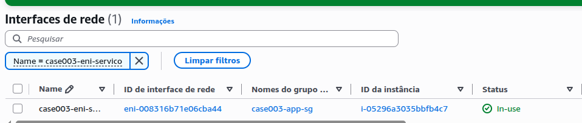

# Case 03 — Solução: O IP é da placa e não do servidor

Registro da execução, das evidências e das conclusões do case.

## Resumo

| Recurso               | Tipo                  | AZ           | IP privado      | Papel no case |
| --------------------- | --------------------- | ------------ | --------------- | ------------- |
| `case003-app-a`       | EC2 (`t3.micro`)      | `us-east-1a` | `172.31.14.223` | Motor de cotação (ativo) |
| `case003-app-b`       | EC2 (`t3.micro`)      | `us-east-1a` | `172.31.10.198` | Motor de cotação (reserva) |
| `case003-cliente`     | EC2 (`t3.micro`)      | `us-east-1b` | `172.31.90.255` | Um dos 12 servidores clientes |
| `case003-eni-servico` | ENI manual            | `us-east-1a` | `172.31.10.100` | **IP do serviço**, que migra entre A e B |

- **Região:** `us-east-1`
- **VPC:** `vpc-01388eff31f452821` (VPC default)
- **Sub-rede de A, B e da ENI:** `subnet-06a1d0ee347d4732d` (`us-east-1a`)
- **Sub-rede do cliente:** `subnet-0488c49afc72f8ba8` (`us-east-1b`)
- **Failover:** mesmo IP `172.31.10.100` e mesmo MAC, de A para B, com **~30 s** de indisponibilidade (contra ~2 h no incidente original) e nenhuma alteração no cliente
- **Ciclo de vida:** previsão de quais ENIs sobreviveriam ao terminate confirmada em **4 de 4**
- **Conta ao final:** 3 instâncias `terminated`, nenhuma ENI ou SG do case, state do Terraform vazio

## Arquitetura

Diagramas editáveis em [architecture.drawio](architecture/architecture.drawio).

### Inicial (o IP do serviço é o IP da eth0)

A situação descrita no case: os 12 clientes chamam o motor de cotação pelo IP da **eth0** do servidor. Quando o servidor foi substituído, o IP foi junto, e as quatro reclamações aparecem no diagrama. Nomes e IPs são **simulados**.


### Implementada (o IP mora na ENI)

O que foi executado no lab, com os recursos e IPs reais: a `case003-eni-servico` (`172.31.10.100`) migra de `case003-app-a` para `case003-app-b` na mesma AZ, o cliente em `us-east-1b` chama sempre o mesmo IP, e o attach em outra AZ é bloqueado.


### Recomendada (NLB interno multi-AZ)

A arquitetura definitiva da [Fase 8](#fase-8--recomendação-de-arquitetura), para quando houver orçamento e o protocolo legado aceitar DNS: Route 53 private hosted zone → NLB interno em 2 AZs → Auto Scaling Group. Recursos **simulados**.


---

## Preparação do ambiente

Infraestrutura provisionada via Terraform ([iac/](iac/)), com módulos do repositório [Terraform-Modules](https://github.com/mgsantos89/Terraform-Modules):

- 2 Security Groups (módulo `SecurityGroup`): `case003-app-sg` e `case003-cliente-sg`
- 3 instâncias EC2 `t3.micro` (módulo `EC2`) com **IMDSv2 obrigatório** e User Data renderizado a partir de [iac/scripts/user-data.sh.tftpl](iac/scripts/user-data.sh.tftpl)
- 1 ENI manual (módulo `ENI`), criada **sem anexo** a nenhuma instância
- Variáveis de exemplo em [iac/example.tfvars](iac/example.tfvars)

```console
❯ terraform state list
module.ec2_app_A.aws_instance.this
module.ec2_app_B.aws_instance.this
module.ec2_cliente.aws_instance.this
module.eni.aws_network_interface.this
module.security_group_APP.aws_security_group.this
module.security_group_APP.aws_vpc_security_group_egress_rule.this["all_ipv4"]
module.security_group_APP.aws_vpc_security_group_ingress_rule.this["http"]
module.security_group_APP.aws_vpc_security_group_ingress_rule.this["ssh"]
module.security_group_cliente.aws_security_group.this
module.security_group_cliente.aws_vpc_security_group_egress_rule.this["all_ipv4"]
module.security_group_cliente.aws_vpc_security_group_ingress_rule.this["http"]
module.security_group_cliente.aws_vpc_security_group_ingress_rule.this["ssh"]
```

> A AMI usada foi **Ubuntu 24.04** (`ubuntu-noble-24.04-amd64-server`), e não Amazon Linux 2023 como sugerido no enunciado. Isso não altera nenhum conceito do case: o User Data instala o **nginx** e publica uma página com o nome da instância.

## Fase 1 — Montar o ambiente

### Evidência: instâncias, AZs e IPs primários

```console
❯ aws ec2 describe-instances --region us-east-1 \
    --filters "Name=tag:Project,Values=case003" "Name=instance-state-name,Values=running" \
    --query 'Reservations[].Instances[].[Tags[?Key==`Name`]|[0].Value,InstanceId,Placement.AvailabilityZone,SubnetId,PrivateIpAddress,NetworkInterfaces[?Attachment.DeviceIndex==`0`]|[0].NetworkInterfaceId,NetworkInterfaces[?Attachment.DeviceIndex==`0`]|[0].Attachment.DeleteOnTermination,SecurityGroups[0].GroupName,State.Name]' \
    --output table
+-----------------+----------------------+-------------+---------------------------+----------------+------------------------+-------+----------------------+-----------+
|  case003-app-b  |  i-0089cbf1ad261eb8c |  us-east-1a |  subnet-06a1d0ee347d4732d |  172.31.10.198 |  eni-05f8fbbfc57485a0d |  True |  case003-app-sg      |  running  |
|  case003-app-a  |  i-05296a3035bbfb4c7 |  us-east-1a |  subnet-06a1d0ee347d4732d |  172.31.14.223 |  eni-06d44dbb1614ad68c |  True |  case003-app-sg      |  running  |
|  case003-cliente|  i-0751de834b3ab659f |  us-east-1b |  subnet-0488c49afc72f8ba8 |  172.31.90.255 |  eni-08997ba1b400cea3d |  True |  case003-cliente-sg  |  running  |
+-----------------+----------------------+-------------+---------------------------+----------------+------------------------+-------+----------------------+-----------+
```

- `case003-app-a` e `case003-app-b` estão na **mesma AZ e na mesma sub-rede** (`us-east-1a`), condição para a ENI poder migrar entre elas.
- `case003-cliente` está em **outra AZ** (`us-east-1b`). Ela será usada na Fase 5 para provar que a ENI não atravessa AZ.
- As três eth0 foram **criadas automaticamente** no launch e estão com **Delete on termination = `True`**, o padrão da AWS para a ENI primária.

### Ambiente

| Recurso            | AZ           | Sub-rede                   | IP privado (eth0) | ENI ID (eth0)            | Delete on termination | Observação |
| ------------------ | ------------ | -------------------------- | ----------------- | ------------------------ | --------------------- | ---------- |
| `case003-app-a`    | `us-east-1a` | `subnet-06a1d0ee347d4732d` | `172.31.14.223`   | `eni-06d44dbb1614ad68c`  | `True`                | `i-05296a3035bbfb4c7` |
| `case003-app-b`    | `us-east-1a` | `subnet-06a1d0ee347d4732d` | `172.31.10.198`   | `eni-05f8fbbfc57485a0d`  | `True`                | `i-0089cbf1ad261eb8c` |
| `case003-cliente`  | `us-east-1b` | `subnet-0488c49afc72f8ba8` | `172.31.90.255`   | `eni-08997ba1b400cea3d`  | `True`                | `i-0751de834b3ab659f` |

### Evidência: User Data executado (nginx no ar)

Trecho do console output (`aws ec2 get-console-output --latest`) das duas instâncias de aplicação:

```console
== case003-app-a (i-05296a3035bbfb4c7)
[  OK  ] Started nginx.service - A high performance web server and a reverse proxy server.
cloud-init[1049]: + systemctl enable --now nginx
cloud-init[1049]: Cloud-init v. 26.1-0ubuntu1~24.04.1 finished at Wed, 11 Nov 2026 08:58:04 +0000.

== case003-app-b (i-0089cbf1ad261eb8c)
[  OK  ] Started nginx.service - A high performance web server and a reverse proxy server.
cloud-init[1046]: + systemctl enable --now nginx
cloud-init[1046]: Cloud-init v. 26.1-0ubuntu1~24.04.1 finished at Wed, 11 Nov 2026 08:58:06 +0000.
```

Cada instância publica uma página com o próprio nome (`<h1>case003-app-a</h1>` / `<h1>case003-app-b</h1>`). Na Fase 3, é esse conteúdo que o cliente vai usar para saber qual servidor está atendendo.

### Evidência: Security Groups com referência entre SGs

```console
❯ aws ec2 describe-security-groups --region us-east-1 \
    --filters "Name=group-name,Values=case003-*" \
    --query 'SecurityGroups[].[GroupName,GroupId]' --output table
+---------------------+------------------------+
|  case003-app-sg     |  sg-05d38c18128d6c4b7  |
|  case003-cliente-sg |  sg-0682029b95db5631b  |
+---------------------+------------------------+

❯ aws ec2 describe-security-group-rules --region us-east-1 \
    --filters "Name=group-id,Values=sg-05d38c18128d6c4b7,sg-0682029b95db5631b" \
    --query 'SecurityGroupRules[?IsEgress==`false`].[GroupId,IpProtocol,FromPort,ToPort,CidrIpv4,ReferencedGroupInfo.GroupId,Description]' \
    --output table
+----------------------+------+-----+-----+------------+-----------------------+-------------------------------+
|  sg-0682029b95db5631b|  tcp |  80 |  80 |  0.0.0.0/0 |  None                 |  HTTP access                  |
|  sg-05d38c18128d6c4b7|  tcp |  80 |  80 |  None      |  sg-0682029b95db5631b |  HTTP access para o CLIENTE   |
|  sg-05d38c18128d6c4b7|  tcp |  22 |  22 |  0.0.0.0/0 |  None                 |  SSH access                   |
|  sg-0682029b95db5631b|  tcp |  22 |  22 |  0.0.0.0/0 |  None                 |  SSH access                   |
+----------------------+------+-----+-----+------------+-----------------------+-------------------------------+
```

A regra da porta **80** do `case003-app-sg` não tem CIDR: ela aponta para o `case003-cliente-sg` (`ReferencedGroupInfo.GroupId = sg-0682029b95db5631b`). Assim, só as ENIs que carregam o SG do cliente conseguem chegar ao motor de cotação, independentemente do IP que elas tenham. No Terraform, isso é feito com o output de um módulo alimentando o outro:

```hcl
http = {
  description                  = "HTTP access para o CLIENTE"
  from_port                    = 80
  to_port                      = 80
  ip_protocol                  = "tcp"
  referenced_security_group_id = module.security_group_cliente.security_group_id
}
```

> A porta 80 do `case003-cliente-sg` está aberta para `0.0.0.0/0` porque o cliente reaproveita o mesmo User Data. Ela não participa do case e pode ser removida.

## Fase 2 — Criar a ENI do serviço

A ENI foi provisionada pelo módulo `ENI` ([iac/module.tf](iac/module.tf)) na mesma sub-rede de A e B, com o SG `case003-app-sg` e **sem `instance_id`**, ou seja, criada solta, sem nenhum servidor. O IPv4 privado foi definido como **Custom**, escolhendo um endereço livre dentro do CIDR da sub-rede (`172.31.0.0/20`):

```hcl
module "eni" {
  source = "git::https://github.com/mgsantos89/Terraform-Modules.git//modules/ENI?ref=main"

  name        = "${var.prefixo_projeto}-eni-servico"
  subnet_id   = var.subnet_id

  # IP Custom do serviço: é este endereço que os 12 clientes usam.
  private_ips = ["172.31.10.100"]

  security_group_ids = [module.security_group_APP.security_group_id]
  # sem instance_id: a ENI nasce desanexada (status Available)
}
```

> Na primeira versão do IaC, o `private_ips` estava comentado e a AWS atribuiu um IP automático (`172.31.10.187`). Para fixar o IP Custom, a ENI foi recriada com `terraform apply -replace=module.eni.aws_network_interface.this`. A AWS não permite trocar o IP primário de uma ENI existente: um novo IP primário exige uma nova ENI, com **novo ID e novo MAC**.

### Evidência: ENI criada e disponível

```console
❯ aws ec2 describe-network-interfaces --region us-east-1 \
    --filters "Name=tag:Project,Values=case003" \
    --query 'NetworkInterfaces[].[TagSet[?Key==`Name`]|[0].Value,NetworkInterfaceId,PrivateIpAddress,MacAddress,AvailabilityZone,SubnetId,Status,InterfaceType,Groups[0].GroupName]' \
    --output table
+---------------------+------------------------+----------------+--------------------+-------------+---------------------------+------------+-------------+------------------+
|  case003-eni-servico|  eni-008316b71e06cba44 |  172.31.10.100 |  02:ff:ff:f8:a6:a3 |  us-east-1a |  subnet-06a1d0ee347d4732d |  available |  interface  |  case003-app-sg  |
+---------------------+------------------------+----------------+--------------------+-------------+---------------------------+------------+-------------+------------------+
```

A ENI está com status **`available`** e **já possui IP privado e MAC address**, mesmo sem estar anexada a nenhum servidor. É a prova direta da premissa do case: **o IP é da placa, não do servidor**.

### Dados da ENI do serviço

| Atributo          | Valor                       |
| ----------------- | --------------------------- |
| ENI ID            | `eni-008316b71e06cba44`     |
| Nome              | `case003-eni-servico`       |
| IP privado        | `172.31.10.100` (Custom)    |
| MAC address       | `02:ff:ff:f8:a6:a3`         |
| AZ / Sub-rede     | `us-east-1a` / `subnet-06a1d0ee347d4732d` |
| Security Group    | `case003-app-sg`            |
| Status            | `available`                 |

### Por que esse IP é o "IP do serviço", e não o da eth0 de A?

Porque a eth0 é a **ENI primária**: ela nasce com a instância, **não pode ser desanexada** e é apagada no terminate. Se os clientes apontassem para `172.31.14.223` (eth0 de A), o IP morreria junto com o servidor A. Já a `case003-eni-servico` tem **ciclo de vida próprio** e pode ser movida de A para B levando o `172.31.10.100` junto.

### Tabela de evidências — ENI do serviço

| Etapa                    | Anexada em | IP da ENI       | MAC address         | Delete on termination | Resposta do `curl` | Observação |
| ------------------------ | ---------- | --------------- | ------------------- | --------------------- | ------------------ | ---------- |
| Criada (Available)       | —          | `172.31.10.100` | `02:ff:ff:f8:a6:a3` | —                     | —                  | IP e MAC existem antes do attach |
| Operação normal          | `case003-app-a` (device index 1) | `172.31.10.100` | `02:ff:ff:f8:a6:a3` | `False` | `case003-app-a` | Status `in-use` |
| Pós-detach               | —          | `172.31.10.100` | `02:ff:ff:f8:a6:a3` | —                     | `FALHOU`           | Force detach às 20:15:12 UTC |
| Pós-failover             | `case003-app-b` (device index 1) | `172.31.10.100` | `02:ff:ff:f8:a6:a3` | `False` | `case003-app-b` | Attach às 20:15:34 UTC |
| Pós-terminate instâncias | —          | `172.31.10.100` | —                   | —                     | —                  | `available`; excluída depois pelo `terraform destroy` |

## Fase 3 — Operação normal

### Evidência: ENI do serviço anexada em `case003-app-a`

A ENI `case003-eni-servico` foi anexada à instância `case003-app-a` (`i-05296a3035bbfb4c7`) e passou de **Available** para **In-use**:



### Evidência: Delete on termination — ENI do serviço × eth0 de A

```console
❯ aws ec2 describe-network-interfaces --region us-east-1 \
    --filters "Name=attachment.instance-id,Values=i-05296a3035bbfb4c7" \
    --query 'NetworkInterfaces[].[TagSet[?Key==`Name`]|[0].Value,NetworkInterfaceId,PrivateIpAddress,MacAddress,Attachment.DeviceIndex,Attachment.Status,Attachment.DeleteOnTermination,Status]' \
    --output table
+---------------------+------------------------+----------------+--------------------+----+-----------+---------+----------+
|  case003-eni-servico|  eni-008316b71e06cba44 |  172.31.10.100 |  02:ff:ff:f8:a6:a3 |  1 |  attached |  False  |  in-use  |
|  None               |  eni-06d44dbb1614ad68c |  172.31.14.223 |  02:ff:e8:9d:8e:71 |  0 |  attached |  True   |  in-use  |
+---------------------+------------------------+----------------+--------------------+----+-----------+---------+----------+
```

| ENI                     | Device index | Criada como                    | Delete on termination | O que acontece no terminate de A |
| ----------------------- | ------------ | ------------------------------ | --------------------- | -------------------------------- |
| `eni-06d44dbb1614ad68c` | 0 (eth0)     | Automática (no launch de A)    | `True`                | É **apagada** junto com a instância |
| `eni-008316b71e06cba44` | 1 (eth1)     | Manual (Terraform, módulo ENI) | `False`               | É **desanexada** e volta para **Available** |

- A eth0 de A aparece com `Name = None`. ENIs criadas automaticamente no launch **não herdam as tags da instância**. Para encontrá-las, é preciso filtrar por `attachment.instance-id` ou `subnet-id`, e não por tag.
- O **MAC address** da ENI do serviço (`02:ff:ff:f8:a6:a3`) é o mesmo registrado na Fase 2, quando ela ainda estava solta. O attach não muda a identidade da placa.

**Por que os valores são diferentes?** A AWS trata cada ENI conforme a origem. A eth0 é criada **para** a instância, e por isso nasce com `DeleteOnTermination = true`: ela não faz sentido sem o servidor. A ENI do serviço foi criada **antes** e de forma independente, e por isso é anexada com `DeleteOnTermination = false`: a AWS preserva um recurso que existia antes da instância, assim como faz com um volume EBS anexado depois do launch. É exatamente esse comportamento que garante que o IP `172.31.10.100` **sobreviva à perda do servidor A**.

### Evidência: cliente chamando o IP do serviço

No `case003-cliente` (`172.31.90.255`, em `us-east-1b`), foi iniciado um loop de `curl` com timestamp contra o IP da ENI. O mesmo loop, sem interrupção, é a evidência da Fase 4:

```console
ubuntu@ip-172-31-90-255:~$ while true; do echo "$(date +%T) $(curl -s -m 1 http://172.31.10.100:80 || echo FALHOU)"; sleep 5; done
20:14:59 <h1>case003-app-a</h1>
<p>Ambiente: SAA-C03</p>
<p>Instance ID: i-05296a3035bbfb4c7</p>
<p>AZ: us-east-1a</p>
```

O cliente, em outra AZ, chega ao motor de cotação pelo IP `172.31.10.100` e recebe a resposta do `case003-app-a`. Isso também confirma a regra entre SGs da Fase 1: o tráfego vem de uma ENI com `case003-cliente-sg` e é aceito pelo `case003-app-sg`.

> O loop usou `sleep 5` em vez de 1 segundo. Isso reduz a precisão da medição para cerca de ±5 s, o que é tratado no cálculo da Fase 4.

## Fase 4 — Simular a falha e executar o failover

O failover foi feito pela console, em dois passos:

1. **Detach** da `case003-eni-servico` em `case003-app-a`, com **Force detachment**, simulando a perda do servidor.
2. **Attach** da **mesma ENI** em `case003-app-b`, com device index 1.

### Evidência: loop do cliente durante o failover

```console
ubuntu@ip-172-31-90-255:~$ while true; do echo "$(date +%T) $(curl -s -m 1 http://172.31.10.100:80 || echo FALHOU)"; sleep 5; done
20:14:59 <h1>case003-app-a</h1>
<p>Ambiente: SAA-C03</p>
<p>Instance ID: i-05296a3035bbfb4c7</p>
<p>AZ: us-east-1a</p>
20:15:04 <h1>case003-app-a</h1>
<p>Ambiente: SAA-C03</p>
<p>Instance ID: i-05296a3035bbfb4c7</p>
<p>AZ: us-east-1a</p>
20:15:09 <h1>case003-app-a</h1>
<p>Ambiente: SAA-C03</p>
<p>Instance ID: i-05296a3035bbfb4c7</p>
<p>AZ: us-east-1a</p>
20:15:14 FALHOU
20:15:20 FALHOU
20:15:26 FALHOU
20:15:32 FALHOU
20:15:38 FALHOU
20:15:44 <h1>case003-app-b</h1>
<p>Ambiente: SAA-C03</p>
<p>Instance ID: i-0089cbf1ad261eb8c</p>
<p>AZ: us-east-1a</p>
20:15:49 <h1>case003-app-b</h1>
<p>Ambiente: SAA-C03</p>
<p>Instance ID: i-0089cbf1ad261eb8c</p>
<p>AZ: us-east-1a</p>
^C
```

O **mesmo IP** (`172.31.10.100`) responde `case003-app-a`, passa por `FALHOU` e volta respondendo `case003-app-b`. O comando do cliente não foi alterado em nenhum momento.

> Durante as falhas, o intervalo entre linhas sobe de 5 para 6 segundos porque o `curl` espera o timeout de 1 s (`-m 1`) antes do `sleep 5`.

### Evidência: ENI anexada em `case003-app-b` com o mesmo MAC

```console
❯ aws ec2 describe-network-interfaces --region us-east-1 \
    --network-interface-ids eni-008316b71e06cba44 \
    --query 'NetworkInterfaces[].[TagSet[?Key==`Name`]|[0].Value,NetworkInterfaceId,PrivateIpAddress,MacAddress,Attachment.InstanceId,Attachment.DeviceIndex,Attachment.DeleteOnTermination,Attachment.AttachTime,Status]' \
    --output table
+---------------------+------------------------+----------------+--------------------+----------------------+----+--------+-----------------------------+----------+
|  case003-eni-servico|  eni-008316b71e06cba44 |  172.31.10.100 |  02:ff:ff:f8:a6:a3 |  i-0089cbf1ad261eb8c |  1 |  False |  2026-11-11T20:15:34+00:00  |  in-use  |
+---------------------+------------------------+----------------+--------------------+----------------------+----+--------+-----------------------------+----------+
```

| Momento               | Instância       | IP              | MAC address         |
| --------------------- | --------------- | --------------- | ------------------- |
| Criada (Fase 2)       | —               | `172.31.10.100` | `02:ff:ff:f8:a6:a3` |
| Antes do failover     | `case003-app-a` | `172.31.10.100` | `02:ff:ff:f8:a6:a3` |
| Depois do failover    | `case003-app-b` | `172.31.10.100` | `02:ff:ff:f8:a6:a3` |

O **MAC address é idêntico** nos três momentos: a placa de rede é a mesma, só mudou de servidor.

### Evidência: linha do tempo no CloudTrail

Os eventos de escrita da conta a partir das 20:00 UTC (filtrando chamadas de leitura) mostram exatamente as duas ações do failover:

```console
❯ aws cloudtrail lookup-events --region us-east-1 --start-time 2026-11-11T20:00:00Z \
    --query 'Events[].[EventTime,EventName,Resources[0].ResourceName]' --output text \
    | grep -viE "Describe|Get|List|Lookup|AssumeRole|ConsoleLogin"
2026-11-11T17:15:36-03:00  NetworkInterfaceAttachmentCompleted  None
2026-11-11T17:15:34-03:00  AttachNetworkInterface               eni-attach-07180fa0deba0f2c4
2026-11-11T17:15:12-03:00  DetachNetworkInterface               eni-attach-0d59ab02e4ba32f2d
2026-11-11T17:10:51-03:00  SendSSHPublicKey                     i-0751de834b3ab659f
2026-11-11T17:10:46-03:00  DetachNetworkInterface               eni-attach-0f84a0f1de1d04028
2026-11-11T17:05:25-03:00  NetworkInterfaceAttachmentCompleted  None
2026-11-11T17:05:24-03:00  AttachNetworkInterface               eni-attach-0d59ab02e4ba32f2d
```

| Hora (UTC) | Evento                                | Detalhe |
| ---------- | ------------------------------------- | ------- |
| 20:05:24   | `AttachNetworkInterface`              | ENI → `case003-app-a` (attachment `eni-attach-0d59ab02e4ba32f2d`), Fase 3 |
| 20:10:51   | `SendSSHPublicKey`                    | Acesso ao `case003-cliente` via EC2 Instance Connect, **antes** do loop começar |
| 20:15:12   | `DetachNetworkInterface` (`force: true`) | Encerra o attachment `0d59…` (ENI sai do A) |
| 20:15:34   | `AttachNetworkInterface`              | ENI → `case003-app-b` (attachment `eni-attach-07180fa0deba0f2c4`) |
| 20:15:36   | `NetworkInterfaceAttachmentCompleted` | Attach concluído na B |

> O `DetachNetworkInterface` de 20:10:46 (attachment `0f84…`) não pertence ao failover: ele não corresponde a nenhum attach da `case003-eni-servico`.

### Nenhuma alteração no cliente

- O loop rodou **sem interrupção** do primeiro `case003-app-a` ao primeiro `case003-app-b`, com o mesmo comando e o mesmo IP.
- O único evento de escrita envolvendo o `case003-cliente` (`SendSSHPublicKey`, 20:10:51) aconteceu **antes** do início do loop (20:14:59). Durante o failover, as únicas ações na conta foram o detach e o attach da ENI.

### Tempo de indisponibilidade

| Evento                                  | Timestamp (UTC) | Fonte |
| --------------------------------------- | --------------- | ----- |
| Última resposta `case003-app-a`         | 20:15:09        | Loop do cliente |
| Detach forçado da ENI em A              | 20:15:12        | CloudTrail |
| Primeira falha                          | 20:15:14        | Loop do cliente |
| Attach da ENI em B                      | 20:15:34        | CloudTrail |
| Attach concluído                        | 20:15:36        | CloudTrail |
| Primeira resposta `case003-app-b`       | 20:15:44        | Loop do cliente |
| **Indisponibilidade observada (loop)**  | **35 s**        | 20:15:09 → 20:15:44 |
| **Indisponibilidade real estimada**     | **~26 a 32 s**  | 20:15:12 → entre 20:15:38 e 20:15:44 |

**Como ler esses números:**

- O loop amostra a cada 5–6 s, então os **35 s** são um limite superior. O serviço caiu de fato no detach (20:15:12) e voltou em algum momento entre a última falha (20:15:38) e a primeira resposta de B (20:15:44).
- Dos ~30 s, **22 s** foram o intervalo entre o detach e o attach (20:15:12 → 20:15:34): é o tempo **humano** de navegar na console e fazer o segundo clique. A AWS levou **~2 s** para concluir o attach, e o sistema operacional da B levou no máximo mais alguns segundos para ativar a interface.
- Comparado ao incidente original (**~2 horas** atualizando 12 clientes), o failover caiu para **~30 segundos**, sem tocar em nenhum cliente. Automatizando os dois passos (CLI, Lambda ou script disparado por um alarme), o tempo cai para poucos segundos, porque o gargalo deixa de ser a pessoa.

> Os relógios do cliente e do CloudTrail são comparáveis: as instâncias EC2 sincronizam a hora com o **Amazon Time Sync Service**, e a sequência dos eventos é coerente (última resposta de A às 20:15:09, antes do detach às 20:15:12, e primeira falha às 20:15:14).

## Fase 5 — Testar os limites de AZ e da eth0

### Evidência: ENI não pode ser anexada a uma instância de outra AZ

Tentativa de anexar a `case003-eni-servico` (`us-east-1a`) ao `case003-cliente` (`us-east-1b`):

```console
❯ aws ec2 attach-network-interface --region us-east-1 \
    --network-interface-id eni-008316b71e06cba44 \
    --instance-id i-0751de834b3ab659f --device-index 1
aws: [ERROR]: An error occurred (InvalidParameterCombination) when calling the AttachNetworkInterface operation: You may not attach a network interface to an instance if they are not in the same availability zone
```

Na console, o mesmo limite aparece de outra forma: o `case003-cliente` **nem aparece na lista** de instâncias do **Attach**, porque a console só lista instâncias da AZ da ENI. A ENI pertence a uma **sub-rede**, e a sub-rede pertence a uma única AZ.

### Evidência: a eth0 não pode ser desanexada

Tentativa de desanexar a ENI primária de `case003-app-a` (`eni-06d44dbb1614ad68c`, attachment `eni-attach-0137283bab3926858`), com e sem `--force`:

```console
❯ aws ec2 detach-network-interface --region us-east-1 --attachment-id eni-attach-0137283bab3926858
aws: [ERROR]: An error occurred (OperationNotPermitted) when calling the DetachNetworkInterface operation: The network interface at device index 0 and networkCard index 0 cannot be detached.

❯ aws ec2 detach-network-interface --region us-east-1 --attachment-id eni-attach-0137283bab3926858 --force
aws: [ERROR]: An error occurred (OperationNotPermitted) when calling the DetachNetworkInterface operation: The network interface at device index 0 and networkCard index 0 cannot be detached.
```

Nem o **Force detachment** remove a eth0 (device index 0). É por isso que o IP do serviço precisa estar numa ENI secundária: o IP da eth0 fica preso ao servidor até o fim da vida dele.

### Por que um Elastic IP não resolveria o problema?

O Elastic IP é um **IP público** associado ao IP privado de uma ENI. Remapeá-lo para B não muda o IP privado que os 12 clientes usam dentro da VPC, e ainda exporia o serviço à internet.

### O que aconteceria com o reserva em outra AZ?

O failover seria impossível: a ENI não atravessa AZ (erro acima). Seria preciso criar outra ENI na sub-rede da outra AZ, **com outro IP**, e voltar a editar os 12 clientes, que é exatamente o incidente original.

## Fase 6 — Reproduzir as ENIs órfãs

### Reproduzindo o erro do analista: Delete on termination desligado na eth0 de B

```console
❯ aws ec2 modify-network-interface-attribute --region us-east-1 \
    --network-interface-id eni-05f8fbbfc57485a0d \
    --attachment AttachmentId=eni-attach-098e51aef2c320630,DeleteOnTermination=false
```

### Evidência: inventário das ENIs antes do terminate

```console
❯ aws ec2 describe-network-interfaces --region us-east-1 \
    --filters "Name=attachment.instance-id,Values=i-05296a3035bbfb4c7,i-0089cbf1ad261eb8c,i-0751de834b3ab659f" \
    --query 'NetworkInterfaces[].[NetworkInterfaceId,TagSet[?Key==`Name`]|[0].Value,Attachment.InstanceId,Attachment.DeviceIndex,PrivateIpAddress,InterfaceType,RequesterManaged,Attachment.DeleteOnTermination,Status]' \
    --output table
+-----------------------+----------------------+----------------------+----+----------------+------------+--------+---------+----------+
|  eni-08997ba1b400cea3d|  None                |  i-0751de834b3ab659f |  0 |  172.31.90.255 |  interface |  False |  True   |  in-use  |
|  eni-008316b71e06cba44|  case003-eni-servico |  i-0089cbf1ad261eb8c |  1 |  172.31.10.100 |  interface |  False |  False  |  in-use  |
|  eni-06d44dbb1614ad68c|  None                |  i-05296a3035bbfb4c7 |  0 |  172.31.14.223 |  interface |  False |  True   |  in-use  |
|  eni-05f8fbbfc57485a0d|  None                |  i-0089cbf1ad261eb8c |  0 |  172.31.10.198 |  interface |  False |  False  |  in-use  |
+-----------------------+----------------------+----------------------+----+----------------+------------+--------+---------+----------+
```

### Previsão (escrita em 2026-11-11 20:26 UTC, antes do terminate)

A regra é uma só: **no terminate, a AWS apaga apenas as ENIs com `DeleteOnTermination = true`**. As demais são desanexadas e ficam **Available**. A forma de criação (automática ou manual) só define o **valor padrão** do atributo.

| ENI                     | Origem                    | Criada como | Anexada em (antes do terminate) | Delete on termination | Previsão | Motivo |
| ----------------------- | ------------------------- | ----------- | ------------------------------- | --------------------- | -------- | ------ |
| `eni-06d44dbb1614ad68c` | eth0 de `case003-app-a`   | Automática  | `case003-app-a` (index 0)       | `True`                | **Apagada** | Padrão da eth0 |
| `eni-05f8fbbfc57485a0d` | eth0 de `case003-app-b`   | Automática  | `case003-app-b` (index 0)       | `False` (alterado)    | **Fica Available (órfã)** | Atributo desligado manualmente |
| `eni-08997ba1b400cea3d` | eth0 de `case003-cliente` | Automática  | `case003-cliente` (index 0)     | `True`                | **Apagada** | Padrão da eth0 |
| `eni-008316b71e06cba44` | `case003-eni-servico`     | Manual      | `case003-app-b` (index 1)       | `False`               | **Fica Available** | Padrão de ENI anexada depois do launch |

Consequências previstas: a eth0 órfã de B vai continuar **ocupando o IP `172.31.10.198`** e vai continuar com o `case003-app-sg`, o que deve **impedir a exclusão do SG** enquanto ela existir.

## Fase 7 — Desmontagem e conferência da previsão

Infraestrutura removida com `terraform destroy` completo. Diferente do case 002, o Terraform **não conseguiu concluir sozinho**: ele não conhece a eth0 órfã de B, que nunca esteve no state, e essa ENI segurava o `case003-app-sg`.

### Evidência: instâncias encerradas

```console
❯ aws ec2 describe-instances --region us-east-1 \
    --instance-ids i-05296a3035bbfb4c7 i-0089cbf1ad261eb8c i-0751de834b3ab659f \
    --query 'Reservations[].Instances[].[InstanceId,Tags[?Key==`Name`]|[0].Value,State.Name]' --output table
+---------------------+-------------------+--------------+
|  i-0089cbf1ad261eb8c|  case003-app-b    |  terminated  |
|  i-05296a3035bbfb4c7|  case003-app-a    |  terminated  |
|  i-0751de834b3ab659f|  case003-cliente  |  terminated  |
+---------------------+-------------------+--------------+
```

### Evidência: ENIs logo após o terminate

Consulta feita depois do terminate e **antes** de o Terraform excluir a ENI do serviço:

```console
eni-06d44dbb1614ad68c: NotFound                                  # eth0 de A
eni-05f8fbbfc57485a0d: available   172.31.10.198   case003-app-sg  # eth0 de B
eni-08997ba1b400cea3d: NotFound                                  # eth0 do cliente
eni-008316b71e06cba44: available   172.31.10.100   case003-app-sg  # case003-eni-servico
```

### Previsão × resultado

| ENI                     | Origem                    | Criada como | Delete on termination | Previsão              | Resultado após terminate | Bateu? |
| ----------------------- | ------------------------- | ----------- | --------------------- | --------------------- | ------------------------ | ------ |
| `eni-06d44dbb1614ad68c` | eth0 de `case003-app-a`   | Automática  | `True`                | Apagada               | Apagada (`NotFound`)     | ✅ |
| `eni-05f8fbbfc57485a0d` | eth0 de `case003-app-b`   | Automática  | `False` (alterado)    | Fica Available (órfã) | `available`, IP `172.31.10.198` | ✅ |
| `eni-08997ba1b400cea3d` | eth0 de `case003-cliente` | Automática  | `True`                | Apagada               | Apagada (`NotFound`)     | ✅ |
| `eni-008316b71e06cba44` | `case003-eni-servico`     | Manual      | `False`               | Fica Available        | `available`, IP `172.31.10.100` | ✅ |

**4 de 4 previsões confirmadas, sem divergências.**

### Evidência: linha do tempo da desmontagem (CloudTrail)

| Hora (UTC) | Evento | Origem | Detalhe |
| ---------- | ------ | ------ | ------- |
| 01:21:51 | `TerminateInstances` ×3 | Terraform | Encerra A, B e o cliente |
| 01:21:52 | `DetachNetworkInterface` | AWS | ENI do serviço desanexada de B (DoT `false`) |
| 01:22:12 | `DeleteNetworkInterface` ×2 | `ec2.amazonaws.com` | A **própria AWS** apaga as eth0 de A e do cliente (DoT `true`) |
| 01:22:22 | `DeleteSecurityGroup` `case003-cliente-sg` | Terraform | ✅ Sucesso: nenhuma ENI restante usava o SG |
| 01:25:33 | `DeleteNetworkInterface` `eni-008316b71e06cba44` | Terraform | ENI do serviço, que estava no state |
| 01:25:34 → 01:29:12 | `DeleteSecurityGroup` `case003-app-sg` ×~25 | Terraform | ❌ `Client.DependencyViolation`: *resource sg-05d38c18128d6c4b7 has a dependent object* |
| 01:29:14 | `DeleteNetworkInterface` `eni-05f8fbbfc57485a0d` | Console | eth0 órfã de B excluída manualmente |
| em seguida | `DeleteSecurityGroup` `case003-app-sg` | Terraform | ✅ Sucesso no retry seguinte, e o destroy termina |

O `DependencyViolation` é a evidência prática da reclamação 4: **uma ENI órfã impede a exclusão do Security Group**, e o Terraform fica repetindo a tentativa até o timeout, porque o recurso que bloqueia **não está no state**. Foi preciso excluir a ENI pela console para destravar o destroy.

### Por que a ENI do serviço continuou existindo após o terminate?

Ela foi criada manualmente e anexada depois do launch, por isso tinha `DeleteOnTermination = false`. O terminate só a desanexou, e ela foi removida depois pelo Terraform, que a gerenciava.

### Por que a eth0 de `case003-app-b` não foi apagada, se ela foi criada automaticamente?

Porque o que decide é o **atributo**, e não a origem. O Delete on termination dela foi alterado para `false` na Fase 6, então a AWS a tratou como uma ENI a ser preservada.

### Evidência: conta limpa

```console
❯ terraform state list
❯

❯ aws ec2 describe-network-interfaces --region us-east-1 \
    --network-interface-ids eni-05f8fbbfc57485a0d    # e eni-008316b71e06cba44
aws: [ERROR]: An error occurred (InvalidNetworkInterfaceID.NotFound) ...

❯ aws ec2 describe-network-interfaces --region us-east-1 \
    --filters "Name=subnet-id,Values=subnet-06a1d0ee347d4732d,subnet-0488c49afc72f8ba8" "Name=status,Values=available" \
    --query 'NetworkInterfaces[].NetworkInterfaceId' --output text
❯

❯ aws ec2 describe-security-groups --region us-east-1 \
    --filters "Name=group-name,Values=case003-*" --query 'SecurityGroups[].GroupName' --output text
❯

❯ aws ec2 describe-instances --region us-east-1 \
    --filters "Name=tag:Project,Values=case003" "Name=instance-state-name,Values=pending,running,stopping,stopped" \
    --query 'length(Reservations)'
0
```

Nenhuma instância ativa, nenhuma ENI **Available** nas sub-redes do case, nenhum SG `case003-*` e state do Terraform vazio.

## Fase 8 — Recomendação de arquitetura

**ENI × Elastic IP para failover:** use **ENI** quando os clientes chegam pelo **IP privado** dentro da VPC (a placa inteira, com IP, MAC e SG, muda de servidor). Use **Elastic IP** quando o acesso vem da **internet**: só o IP público é remapeado para outra instância, inclusive em outra AZ.

**Limitações e arquitetura recomendada:** o failover com ENI é **manual** (~30 s, quase todo de tempo humano) e **preso a uma AZ**: se `us-east-1a` cair, A, B e o IP caem juntos. Com orçamento, o recomendado é um **NLB interno** em 2 AZs com um **Auto Scaling Group** atrás, e os clientes apontando para um registro DNS numa **Route 53 private hosted zone**. Enquanto isso não acontece, automatizar o detach/attach (alarme do CloudWatch → Lambda) reduz o tempo de troca para poucos segundos.

**Regra operacional para Delete on termination e ENIs órfãs:** manter `true` na eth0 (o padrão) e só desligar com motivo registrado em **tag** (por exemplo `Retain=true` e o dono). Fazer uma revisão periódica das ENIs com status **Available** (`describe-network-interfaces --filters Name=status,Values=available`), excluindo as que não tiverem tag de retenção.

---

## Critérios de aceite

| #  | Critério | Status | Evidência |
| -- | -------- | ------ | --------- |
| 1  | Mesmo IP respondendo `Servidor A` antes e `Servidor B` depois do failover | ✅ Atendido | [Fase 4](#evidência-loop-do-cliente-durante-o-failover) |
| 2  | MAC address da ENI idêntico antes e depois da migração | ✅ Atendido | [Fase 4](#evidência-eni-anexada-em-case003-app-b-com-o-mesmo-mac) |
| 3  | Nenhuma alteração feita no cliente durante o failover | ✅ Atendido | [Fase 4](#nenhuma-alteração-no-cliente) |
| 4  | Tempo de indisponibilidade registrado com timestamps | ✅ Atendido | [Fase 4](#tempo-de-indisponibilidade) |
| 5  | ENI não pode ser anexada a instância de outra AZ e eth0 não pode ser desanexada | ✅ Atendido | [Fase 5](#fase-5--testar-os-limites-de-az-e-da-eth0) |
| 6  | `case003-app-sg` liberando a porta 80 apenas a partir de `case003-cliente-sg` (sem CIDR aberto) | ✅ Atendido | [Fase 1](#evidência-security-groups-com-referência-entre-sgs) |
| 7  | Tabela ENI × criada como × Delete on termination × previsão × resultado, com previsão antes do terminate | ✅ Atendido | [Fase 6](#previsão-escrita-em-2026-11-11-2026-utc-antes-do-terminate) e [Fase 7](#previsão--resultado) |
| 8  | eth0 de `app-a` e `cliente` apagadas; ENI do serviço e eth0 de `app-b` ficaram **Available** | ✅ Atendido | [Fase 7](#evidência-enis-logo-após-o-terminate) |
| 9  | Explicação de ENI (IP privado) × Elastic IP (IP público) para failover | ✅ Atendido | [Fase 5](#por-que-um-elastic-ip-não-resolveria-o-problema) e [Fase 8](#fase-8--recomendação-de-arquitetura) |
| 10 | Recomendação de arquitetura e regra operacional para Delete on termination | ✅ Atendido | [Fase 8](#fase-8--recomendação-de-arquitetura) |
| 11 | Conta limpa: instâncias encerradas, nenhuma ENI do case e SGs removidos | ✅ Atendido | [Fase 7](#evidência-conta-limpa) |

---

## Fora do escopo deste case

O foco deste lab é o comportamento da ENI (IP privado, migração, limite de AZ e ciclo de vida). Por isso, algumas boas práticas ficaram de fora de propósito. Elas são necessárias em um ambiente produtivo e serão exploradas em cases futuros:

- **Alta disponibilidade real:** NLB interno multi-AZ, Auto Scaling Group e registro DNS em Route 53 private hosted zone, no lugar do failover manual numa única AZ.
- **Failover automatizado:** health check com alarme do CloudWatch disparando uma Lambda (ou SSM Automation) que faz o detach/attach da ENI.
- **Acesso e rede:** as instâncias receberam IP público e SSH aberto para `0.0.0.0/0`. O correto é usar sub-rede privada e **AWS Systems Manager Session Manager**, sem porta 22 exposta.
- **Governança do IaC:** backend remoto do Terraform (S3 com state locking), módulos com versão fixada (`?ref=<tag>`) e nenhuma alteração fora do Terraform. A eth0 órfã deste case mostra como um recurso fora do state trava o `destroy`.
- **Higiene de ENIs:** tag de retenção obrigatória e revisão periódica automatizada de ENIs **Available** (AWS Config ou script agendado).

---
